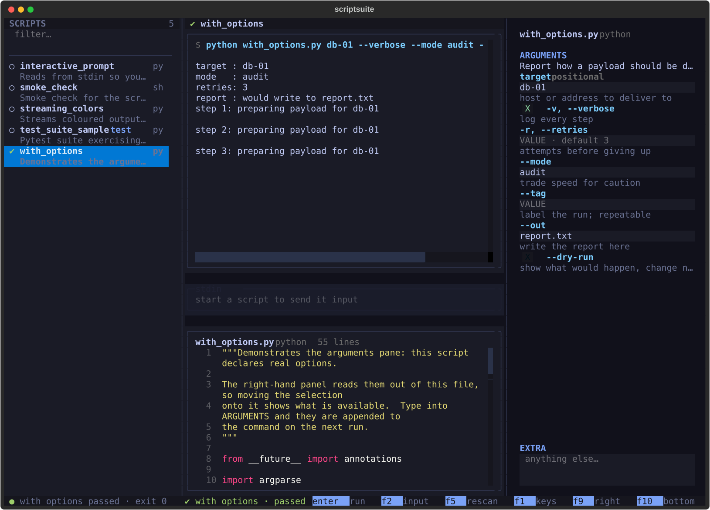

<h1 align="center">scriptsuite</h1>
<p align="center"><em>A modern terminal workspace for driving test scripts.</em></p>

`scriptsuite` scans a `script/` folder, lists everything runnable in a sidebar,
runs the selected script in a **real pseudo-terminal**, and streams its output
and stdin interaction back while you watch. The right pane holds that script's
**arguments and declared options**; the bottom pane holds its **source**.



<p align="center">
  <sub>Python 3.11+ · one dependency (Textual) · MIT</sub>
</p>

---

## Contents

- [Why](#why)
- [Install](#install)
- [Use](#use)
- [Keys](#keys)
- [What it does](#what-it-does)
  - [Discovers scripts](#discovers-scripts)
  - [Runs them like a terminal would](#runs-them-like-a-terminal-would)
  - [Shows output as it happens](#shows-output-as-it-happens)
  - [Summarises results](#summarises-results)
  - [Sends input both ways](#sends-input-both-ways)
  - [Follows the prompt](#follows-the-prompt)
  - [Shows each script's interface](#shows-each-scripts-interface)
  - [Shows the source](#shows-the-source)
- [Layout](#layout)
- [Development](#development)
- [Notes](#notes)

## Why

Running a test script usually means leaving the editor, remembering the flags,
and reading output in a terminal you cannot navigate. `scriptsuite` is one
screen for that: the scripts you have, what each one accepts, what it just
printed, and its source — with the run happening in the middle.

## Install

```sh
python -m venv .venv
.venv/bin/pip install -e .
```

The only runtime dependency is [Textual](https://textual.textualize.io/).

For the development extras (tests, linting, docs):

```sh
.venv/bin/pip install -e ".[dev]"
```

## Use

```sh
scriptsuite                     # uses ./script, then ./scripts
scriptsuite path/to/scripts     # explicit folder
scriptsuite --list              # print what was discovered, then exit
```

| Option | Meaning |
|---|---|
| `DIR` / `-s`, `--scripts-dir` | scripts folder to scan |
| `-p`, `--python` | interpreter for Python scripts (default: the one running `scriptsuite`) |
| `--no-recursive` | only scan the top level |
| `-V`, `--version` | print the version |

`SCRIPTSUITE_SCRIPTS_DIR` sets the folder without a flag. If nothing is
found, the interface says which folder it looked at and what it accepts,
rather than showing an empty list.

## Keys

### Scripts

| Key | Action |
|---|---|
| `↑ ↓` `j k` | move through the list |
| `enter` | run the highlighted script |
| `/` | jump to the filter |
| `f5` | rescan the folder |
| `ctrl+a` | run every visible script in sequence |
| `ctrl+p` | command palette |
| `f1` | key reference |
| `ctrl+q` | quit |

### Running

| Key | Action |
|---|---|
| `ctrl+r` | re-run |
| `ctrl+k` | stop the run (SIGTERM) |
| `ctrl+c` | interrupt the run (SIGINT) |
| `ctrl+l` | clear the output |

### Stdin

| Key | Action |
|---|---|
| `f2` | jump to the input bar (not needed at a prompt) |
| `enter` | send the line to the script |
| `↑ ↓` | recall previous input |
| `f6` | raw mode: forward every keystroke |
| `escape` | give focus back to the list |

### Arguments

| Key | Action |
|---|---|
| `f3` | jump to the first argument control |
| `tab` | next argument control (switches are checkboxes) |
| `space` | toggle a switch |
| `ctrl+u` | clear every argument for this script |

### Layout

| Key | Action |
|---|---|
| `f7` | expand / restore the source pane |
| `f9` `f10` `f11` | toggle the right / bottom / sidebar pane |

## What it does

### Discovers scripts

Everything runnable in the folder, recursively: `.py`, `.sh`, `.js`, `.rb`,
`.pl`, `.exp`, `.tcl`, … An unknown extension is not a veto — if the file
carries a `#!` shebang, the shebang decides how to run it and wins over the
extension. Descriptions come from the module docstring, or from the first
comment for everything else; files that import `pytest`/`unittest` or subclass
`TestCase` are tagged as tests.

### Runs them like a terminal would

Each run gets its own pty, so colours, cursor control and progress bars all
behave and `isatty()` is true inside the script. The child runs in its own
session, so `Ctrl-C` reaches the script rather than the interface. Window size
changes are pushed down and `SIGWINCH` is sent, so full-screen programs redraw
correctly.

### Shows output as it happens

Reads are decoded incrementally: escape sequences split across reads are
reassembled and ANSI colour is preserved. A progress bar that repaints with
`\r` collapses onto one line instead of flooding the log, while an unterminated
prompt like `Enter your name:` still appears within ~120 ms. A carriage return
is replayed the way a terminal does — move to column 0, then overwrite — which
matters because a pty expands a program's `\r\n` into `\r\r\n`.

### Summarises results

pytest, unittest and TAP output are parsed into counts and a verdict. The
verdict overrides the raw exit code, so a suite reporting failures shows as
failed even when something masks the exit status. Failed test names are pulled
out for the sidebar. A script that prints nothing gets no invented numbers,
just its exit code.

### Sends input both ways

Type a line and press `enter` to send it to the script's stdin, with history
on `↑ ↓`. In raw mode every keystroke is forwarded verbatim, for programs that
want arrow keys and escape sequences.

### Follows the prompt

When a script asks a question, the caret moves to the input bar by itself — no
`f2`. The tell is an unterminated line that stopped changing: a progress bar
repaints continuously, so it never looks settled and never steals focus. Focus
is only taken from the sidebar or the output; if you have gone to the arguments
or the source on purpose it is left alone, and `escape` means what it looks
like — stay there until the next question. When the run ends, focus returns to
the list rather than stranding a disabled field.

### Shows each script's interface

Every declared argument gets its own control — a text field for values, a
checkbox for switches — ordered the way a command line is: positionals, then
named options, then whatever is left in the free-form box underneath. Values
are remembered per script as you move through the list. The interfaces are read
from the source:

- **Python** — `argparse` is parsed with `ast`, so flags, help text, whether an
  option takes a value, its choices, its metavar and whether it repeats all come
  through accurately. Positional arguments get a field each.
- **Expect and Tcl** — a `cmdline::getoptions` block is decoded, including the
  `name.type` form, so a spec like `{host.arg "" "Target host"}` becomes a
  `--host` field. Everything is passed with a leading `--`, which is what the
  package expects: `expect` reserves single-dash options for itself. `$argv`
  access becomes positional fields.
- **Shell** — `getopts` optstrings are decoded properly; otherwise only long
  flags that something documents are shown, because a bare `-c` is more often
  `wc -c` than an option.
- **Python without `argparse`** — positional fields, from whichever `sys.argv`
  index the script reads.

Where nothing can be found, the pane says so rather than guessing.

### Shows the source

The bottom pane holds the highlighted script, syntax highlighted and read-only,
with line numbers. Highlighting uses Pygments through Rich, so no tree-sitter
grammar is needed; Expect borrows the Tcl lexer, which is what it is. Long
lines wrap rather than disappearing behind a horizontal scrollbar, and an
oversized file is truncated with a note rather than stalling the interface.
`f7` expands the pane to fill the workspace when you want to read rather than
watch.

## Layout

Four regions on plain flex containers, so hiding a pane is a single
`display: none` and its space flows back to its siblings — no grid bookkeeping.
The sidebar, arguments pane and source pane each live in their own module under
`widgets/`, mounted from `app.py`.

The layout tightens on narrow terminals: below 112 columns the side panes
shrink, below 92 the right pane is hidden until you ask for it with `f9`.

## Development

```sh
.venv/bin/python -m pytest             # 268 tests
.venv/bin/ruff check src tests
.venv/bin/ruff format src tests
```

Regenerating the docs, which needs no extra dependencies — `markdown_it` and
`pygments` both ship with Textual:

```sh
.venv/bin/python tools/screenshot.py   # docs/screenshot.svg, from the real UI
.venv/bin/python tools/build_docs.py   # docs/index.html, self-contained
```

| Module | Responsibility |
|---|---|
| `ansi.py` | incremental bytes → styled Rich text |
| `discovery.py` | finding scripts and reading their metadata |
| `options.py` | reading a script's command-line interface |
| `runner.py` | the pty, process lifecycle, signals |
| `results.py` | incremental test-output parsing |
| `app.py` | layout, run orchestration, keybindings |
| `widgets/` | sidebar, output, stdin, arguments, source, header, status |

`script/` holds sample scripts covering streaming output, an interactive prompt,
a pytest run with deliberate failures, and one that declares `argparse` options
so the right pane has something to show.

## Notes

- One run at a time; starting a new one retires the previous.
- Output is capped at 10,000 lines.
- The sidebar never auto-scrolls away from a run you are watching.
- `ctrl+a` walks the visible list in order and advances even if a script needs
  to be stopped — it will wait on an interactive script until you stop it.
- Argument values live in memory for the session, so they reset on restart.

---

<p align="center"><sub>MIT licensed · built with <a href="https://textual.textualize.io/">Textual</a></sub></p>